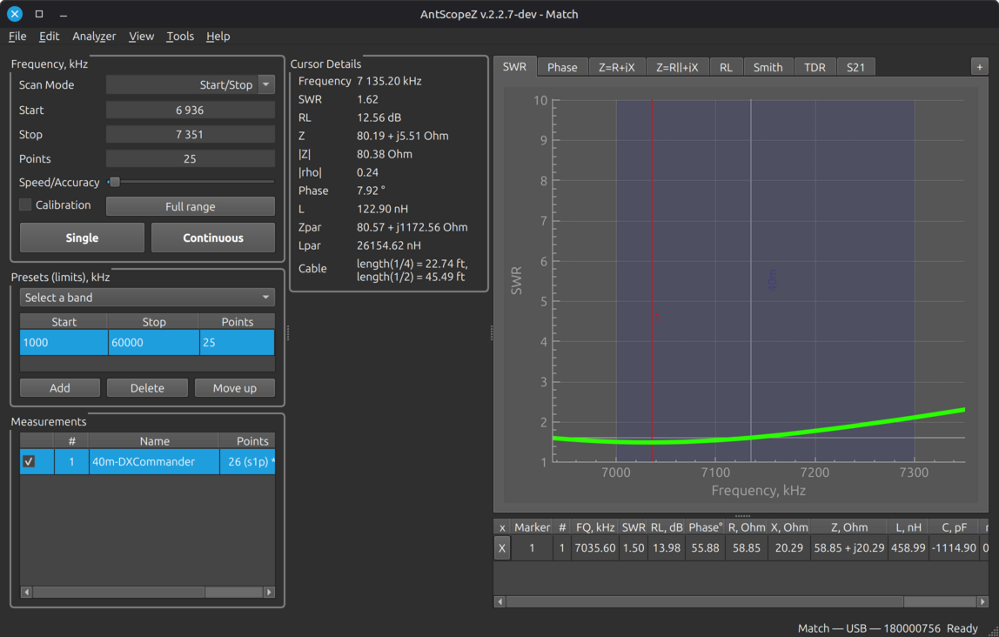

# AntScopeZ

A modern antenna-analyzer application for RigExpert and NanoVNA analyzers
(plus a few other brands), for Windows, Linux and macOS, with a companion
app for Android and iOS. Built for, and maintained by, the ham radio
community.

**Website and screenshots: [k4hez.github.io/AntScopeZ](https://k4hez.github.io/AntScopeZ/)**
&nbsp;·&nbsp;
[Download the latest release](https://github.com/K4HEZ/AntScopeZ/releases/latest)



AntScopeZ is a fork of RigExpert's own AntScope2 software, renamed to keep
this project's identity, config files and installed package clearly
separate from the vendor's. **It is not an official RigExpert project.** Do
not contact them for support for it. It is provided AS-IS and I do not
accept any responsibility for its use. For important tasks such as
licensing and firmware updates, use the vendor's own software instead:
those features talk to RigExpert's servers, aren't officially supported
here, and firmware flashing specifically stays deliberately disabled
pending more real-hardware testing. The original AntScope2 is available
from [rigexpert.com/software/antscope2](https://rigexpert.com/software/antscope2/).

Some of the non-English UI translations are AI-generated and haven't been
reviewed by a native speaker yet -- expect rough edges until that happens.

## Features

- RigExpert analyzers and NanoVNA (classic ASCII and V2/binary), over USB
  serial/HID and Bluetooth (BLE), auto-detected where possible
- Sweep, **Tuning** and **TDR** modes: a live single-frequency SWR readout
  with a big SWR number and a draggable band indicator; and time-domain
  reflectometry with a live-drawing chart, an events table of every
  reflection found, your own distance markers, a velocity-factor
  calculator and over 100 searchable cable presets
- SWR, Phase, Z (series and parallel), Return Loss, Smith and S21/S12
  charts, synced across a Multi view, with markers and a marker comparison
  and trim calculator
- OSL calibration, and cable add/subtract, applied per measurement
- Auto-stitched scans of thousands of points
- Import and export of Touchstone and other files (`.asd`, `.s1p`, `.s2p`,
  `.csv`, `.nwl`), including full 2-port S-parameters
- Customizable bands and presets, ITU band highlighting, a built-in theme
  editor, and a print/PDF layout with a page preview
- Debug logging for analyzer communications, and an optional local
  [Remote API](#remote-api) for scripting
- English, Ukrainian, Japanese and Spanish (AI-generated)

See the [User Guide](docs/user-guide.md) for the full feature list and the
[supported devices](docs/user-guide.md#supported-devices).

## Supported platforms

| Platform | How you get it | Status |
|---|---|---|
| Linux (x86-64, Debian/Ubuntu family) | `.deb` package | Developed and used here daily |
| Windows (64-bit) | Installer (`.exe`) | Builds, packages and launches in CI; not yet exercised against real analyzer hardware on Windows |
| macOS Sonoma (14.4) or newer (Apple Silicon and Intel) | `.dmg` | Builds and launches; unsigned and not notarized |
| Android | APK (pre-release) | Developed and working; a pre-release APK is on the Releases page, not on Google Play |
| iOS | -- | Developed and working (verified on a real iPhone over Bluetooth), **not yet released on the App Store**. Bluetooth analyzers only |

## Download and install

Packages are on the
[Releases page](https://github.com/K4HEZ/AntScopeZ/releases). The
[User Guide's install section](docs/user-guide.md#installing-and-uninstalling)
has the full steps for each platform, including upgrading and uninstalling.

- **Linux:** `sudo apt install ./antscopez_<version>_amd64.deb`
- **Windows:** run `AntScopeZ-<version>-win64.exe`. The installer is
  unsigned, so SmartScreen may warn: **More info** > **Run anyway**.
- **macOS:** open `AntScopeZ-<version>-macOS.dmg` and drag the app to
  Applications. The app is unsigned and not notarized, so on first launch
  right-click it > **Open** (once), or run `xattr -cr AntScopeZ.app`.
- **Android:** download the `.apk` from the pre-release on the Releases page
  and open it (Android will ask you to allow installing from your browser).
  These builds are debug-signed. See
  [testing a pre-release](docs/mobile-beta-testing.md).
- **iOS:** the app is developed and working, but not yet released on the
  App Store, so there is nothing to install yet.

Packaged releases bundle the Qt libraries they need, so no separate Qt
install is required.

## Documentation

- **[User Guide](docs/user-guide.md)** -- using AntScopeZ: devices,
  scanning, calibration, TDR, tuning, files and troubleshooting
- **[Mobile Guide](docs/mobile-guide.md)** -- the Android and iOS app
- **[Changelog](CHANGELOG.md)** -- what changed, release by release
- **[Roadmap](docs/roadmap.md)** -- what's covered, and what's still open
- **[BUILDINFO.md](BUILDINFO.md)** -- building from source, platform notes
  and known issues
- **[Third-party licenses](THIRD-PARTY-LICENSES.md)**

## Building from source

You need CMake 3.21+, a C++17 compiler, and Qt 6.12 including the
SerialPort and Bluetooth (Connectivity) add-on modules; Linux also needs a
few system packages. Linux, Windows, macOS, the mobile app and `.deb`
packaging each have their own steps, and CMake presets for the common
setups -- all in [BUILDINFO.md](BUILDINFO.md). As a quick start on Linux:

```sh
cmake --preset release      # the Qt path is set in CMakePresets.json
cmake --build --preset release -j8
```

## Remote API

AntScopeZ can expose a local control API (NDJSON over TCP, loopback only)
for the connected analyzer -- device enumeration, connect/disconnect, sweeps
and live point streaming -- for scripts, an MCP server or a dashboard. It's
off by default: enable it in Settings > Graphs, or pass
`-remote-api-port <n>` for a single run. `-headless` runs without showing
the window. Protocol details are in [`core/remoteapi/`](core/remoteapi/).

## Credits

The cable presets in `shared/cables.txt` (over 100 cables, inherited from
AntScope2) come from these sources:

- **Dan Maguire, AC6LA** ([ac6la.com](https://www.ac6la.com)) -- Belden and
  Wireman loss data. Most other entries were fitted with his BestFit
  workbook (part of his XLZIZL package).
- **Odeskabel** ([odeskabel.com](https://www.odeskabel.com)) -- RK 50/75 series
- **Fujikura** -- D-2V / C-2V series
- **Messi & Paoloni** ([messi.it](https://messi.it)) -- M&P series
- **RF Parts** ([rfparts.com](https://www.rfparts.com/coax/heliaxcoax.html)) -- HELIAX® data
- **Times Microwave Systems** ([timesmicrowave.com](https://www.timesmicrowave.com)) -- LMR® / TCOM®
- **SSB-Electronic** -- AIRCOM PLUS®, AIRCELL®, ECOFLEX

HELIAX is a trademark of CommScope; LMR and TCOM of Times Microwave
Systems; AIRCOM PLUS and AIRCELL of SSB-Electronic.

If your work appears in AntScopeZ and we failed to give proper credit,
please [open an issue](https://github.com/K4HEZ/AntScopeZ/issues) and
we'll be happy to fix it.

## License

AntScopeZ, as built and distributed, is licensed under the **GNU General
Public License v3.0 or later** (see [`COPYING`](COPYING)) -- it bundles
GPLv3-licensed components (QCustomPlot, HIDAPI), which makes the combined
application GPLv3 as a whole. AntScopeZ's own source -- both the original
RigExpert AntScope2 codebase it's forked from and everything added or
modified since -- is separately available under the MIT license
([`LICENSE.txt`](LICENSE.txt)). Qt and libusb are used under their LGPL
terms, and a Windows-only FTDI
driver package is bundled under FTDI's own proprietary redistribution
terms. Full per-component licenses and platform-specific notes:
[`THIRD-PARTY-LICENSES.md`](THIRD-PARTY-LICENSES.md).
